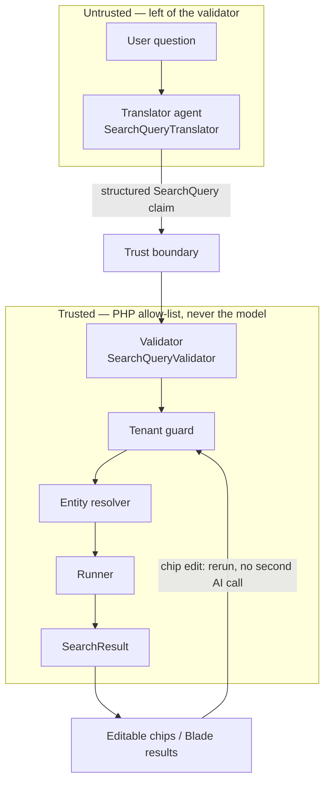

# Search architecture

The model produces a *description of a query*. PHP decides what that description is allowed
to do. Every security property in this demo depends on that split.

## Pipeline



Everything **left of the validator is untrusted**: the raw question, the prompt, and the
JSON the model emitted. A valid-looking `SearchQuery` is still only a claim. The validator
is the first trusted gate. Tenant scope, soft-delete exclusion, PII stripping, and the
limit clamp happen even later, in the runner, and they ignore the claim when it conflicts
with policy.

## Stages

### 1. Question

`GET /search/results?q=...` or the Livewire search panel. Hard limits run first, before
any model call:

- questions longer than `AI_SEARCH_MAX_QUESTION_LENGTH` (default 500) are blocked
- 20 searches per user per minute (`RateLimiter`)

### 2. Translator agent

`App\Ai\Agents\SearchQueryTranslator` is a structured-output agent. It has no database
access and no mutating tools. Its instructions are rendered from `SearchSchema` — the same
allow-list the validator uses — plus today's date and the actor's role. It never sees
customer rows, `tax_id`, or note bodies.

It emits a `SearchQuery` plus `confidence`, `interpretation`, and optional
`clarification_needed`. It must **not** resolve names to IDs. `John Smith` stays
`customer_name contains 'John Smith'`.

On validation failure, `SearchQueryTranslatorService` retries **once** with the validator
error. A second failure becomes `TranslationFailed`, not an exception in the UI path.

### 3. Validator — trust boundary

`SearchQueryValidator` rejects unknown entities, unknown fields, denied fields
(`customers.tax_id`, `request_notes.is_internal`), illegal operators, `limit` above 200,
unknown sort keys, and malformed dates.

This is the line on the diagram. Left: untrusted model output. Right: a query that is at
least *well-formed*. Well-formed is not yet *authorized*.

### 4. Tenant guard

`TenantGuard` blocks a search that would read another tenant's data (explicit `company_id`
or a foreign `customer_id`) and logs the attempt as `blocked`.

### 5. Entity resolver

`EntityResolver` runs a tenant-scoped, non-trashed customer lookup:

| Matches | Outcome |
|---|---|
| 0 | not-found message |
| 1 | substitute `customer_id = N` |
| 2+ | disambiguation candidates; do not guess |

Soft-deleted and other-tenant customers are invisible here.

### 6. Runner

`SearchQueryRunner::run()` applies the non-negotiable PHP rules **regardless of what the
query says**:

1. `where('company_id', $actor->company_id)` on the root entity
2. soft-deleted rows excluded — there is no include-trash flag
3. `limit` clamped to `min($query->limit, 200)`
4. denied columns stripped; `tax_id` selected only when `$actor->role === 'admin'`
5. relations eager-loaded for display
6. statement timeout where the driver supports it

`SearchResult` carries `rows`, `total`, `truncated`, the post-validation `appliedQuery`,
and compiled SQL for the admin debug panel.

### 7. Result and editable chips

The interpretation sentence and filter chips are the product. Editing or removing a chip
calls `SearchService::rerun()` — validator, tenant guard, runner. **No second AI call.**
The AI produced an editable query, not an answer.

Server-rendered `GET /search/results` is the no-JavaScript path. Livewire `SearchPanel` is
the one dynamic component, justified only because chips must be editable in place.

## Trust boundary (the point of the video)

```
question ──► prompt ──► model JSON ──► SearchQuery
                                      │
                                      ▼
                              ┌───────────────┐
                              │   validator   │  ← first trusted gate
                              └───────────────┘
                                      │
          tenant scope · soft deletes · PII · limit clamp
                                      │
                                      ▼
                                   result
```

Stored note bodies are an injection vector (Phase 1 seeder). They never enter this
pipeline. If a later summarization step feeds row text to a model (Phase 13), wrap it with
`App\Ai\UntrustedText::wrap()`.

## Audit

Every search — including failures and blocks — writes `ai_search_logs`: question,
interpretation, query JSON, compiled SQL, tokens, estimated cost, outcome
(`ok` / `clarification` / `failed` / `blocked`). Admins read them at `/admin/ai-logs`.
